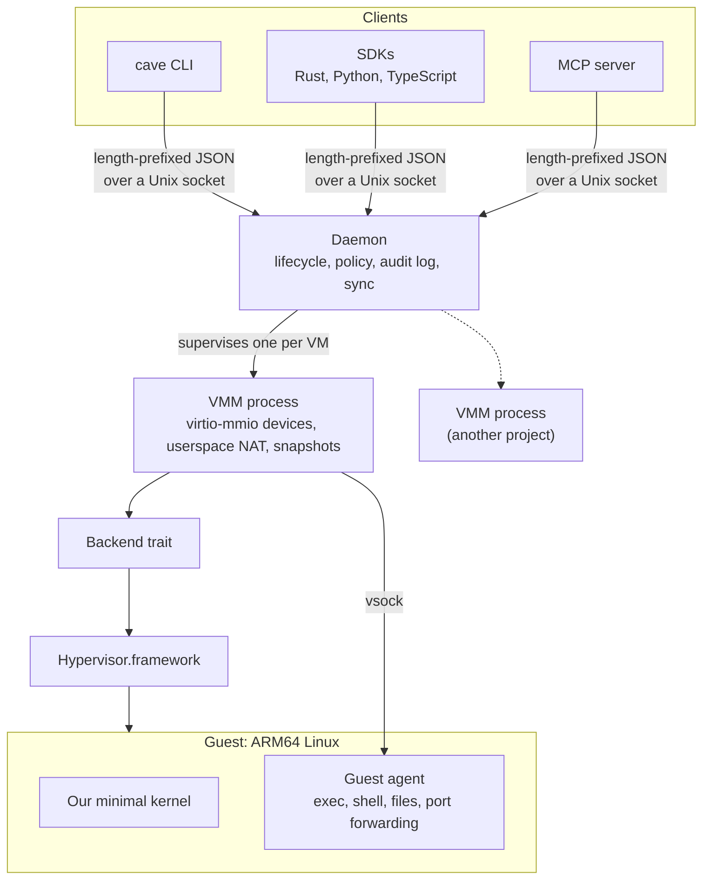
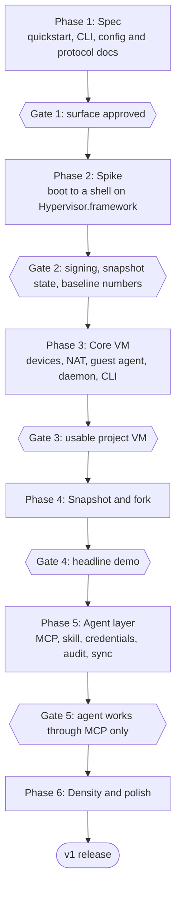

# CAVE: Coding Agent Virtual Environment (Planning Doc)

Oct 11, 2026 · @Ivan

> This is the design written before cave was built, kept in its planning voice: "decided" marks what was settled then, and targets such as "in milliseconds" were measured later in the spike. Changes since then have a decision record in [`decisions/`](decisions/) and are folded in here. For cave as it ships, read [cli.md](cli.md), [config.md](config.md) and [protocol.md](protocol.md).

## Pitch

CAVE is a microVM runtime for macOS that gives each coding-agent project its own fast, disposable Linux machine, with one-command install and no setup.

Agents are most useful when you stop approving every command, and most risky at the same moment. CAVE makes that safe: the agent works inside a hardware-isolated VM, you snapshot before risky work, and you roll back or fork the whole project in milliseconds (a target, to be measured in the spike).

The VMM itself is a mostly solved problem (Firecracker, libkrun). CAVE's edge is the experience around it: zero-setup install, a VM per project directory, visible safety, and first-class agent integration.

CAVE stands for Coding Agent Virtual Environment. The name is decided: packages, the repo and crates use `cave-vm`, and the command is `cave`.

## Goals and non-goals

v1 is a developer tool whose edge is low setup friction, not renamed vocabulary. Terms like VM, snapshot, image and fork stay.

**Goals**

- Easy to install and use: one install command, and first run handles everything itself.
- Fast startup and low memory: direct kernel boot, copy-on-write snapshots, ballooning.
- Customizable and programmable: CLI, SDK and MCP server over the same engine.
- Built for coding agents: sandboxed by default, with an agent skill and tooling shipped in the box.
- Visible safety: what the VM can reach is always inspectable.

**Non-goals for v1**

- A `.app` bundle or GUI.
- Windows or macOS guests, x86 emulation, GPU, USB.
- Competing with Parallels or UTM as a desktop virtualizer.
- App Store distribution (the hypervisor entitlement and sandboxing make it awkward).
- OCI image support. v1 ships one curated base image.
- Live two-way file sync.
- A virtiofs-style host folder mount.

## Audience and design principles

The audience is developers and agent users who are comfortable in a terminal but tired of setting up VMs. Agent frameworks that want a fast local sandbox through an SDK are the second audience; the same engine serves both.

1. **One command to a running environment.** `cave run` works with no config, using a bundled kernel and the default image.
2. **First run does everything.** It fetches the kernel and base image, handles entitlements and codesigning, creates the data directory and runs a health check. Errors say what is wrong and how to fix it.
3. **`cave doctor`** re-runs the same checks on demand.
4. **Sensible defaults, escape hatches underneath.** The common path has no flags; CPU, memory, devices and kernel args are reachable when needed.
5. **No SSH or cloud-init.** A guest agent over vsock handles exec, shell, file copy and port forwarding.
6. **Names, not IDs.** A consistent verb set: `run`, `exec`, `shell`, `ls`, `rm`, `snapshot`, `fork`, `restore`.
7. **Write the README quickstart first.** If it takes more than two commands, simplify the design.

## Core model: one VM per project directory

The project directory is the identity of the VM, the way a repo directory is the identity of a git repository. There is no registry and no naming: `cd project1 && cave shell` boots or restores that project's VM. Deleting the folder deletes everything, so no orphaned disks pile up.

```
Desktop/Projects/project1/
  AGENTS.md        # tells agents to work inside the VM
  cave.toml        # small config, committed to git
  .cave/           # disk, snapshots, memory state, audit log (gitignored)
```

- Every project disk is a copy-on-write clone (APFS `clonefile`) of one shared base image, so ten projects do not cost ten full disks.
- A running project can be suspended to a snapshot, so reopening it is a fast restore with processes intact.
- `.cave/` is machine-specific. `cave.toml` plus a pinned base-image digest rebuilds the environment anywhere.
- No absolute paths inside `.cave/`, so moving or copying the folder does not break it.
- Because `.cave/` can hold real work (see sealed storage below), `rm -rf .cave` needs a deliberate step: `cave rm` asks for confirmation, and `cave gc` shows disk usage.

A minimal `cave.toml`:

```toml
[vm]
image   = "base"        # pinned to a digest on first run
cpus    = 2
memory  = "2G"

[storage]
mode    = "sealed"      # or "synced"

[network]
mode    = "nat"        # off | nat
```

## Storage modes and sync rules

The code lives inside the VM, and the VM is always authoritative. The Mac copy, when it exists, is a convenience and backup mirror. The user picks the mode when the project is set up.

| Mode | Where code lives | Mac editor / Spotlight | Isolation | Setup question |
| --- | --- | --- | --- | --- |
| `sealed` | VM disk only | no | strongest; no host files reachable | default |
| `synced` | VM disk, plus a Mac mirror | yes | same; the agent never touches the mirror | "Keep a copy of the code on your Mac?" |

**Rules**

1. The VM is authoritative. The agent only ever works inside it.
2. Sync is one-directional by default: the host-side daemon writes the Mac mirror after agent runs, on snapshot, or on `cave sync`. The mirror is never written by the agent.
3. Mac edits are detected by file hash: `cave push` compares the SHA-256 of each file in the Mac copy against the VM's and applies the files that changed on the Mac. A file that changed only on the Mac is applied, one that changed only in the VM is left alone, and one that changed on both sides since the last sync stops the push and is listed. A snapshot is taken automatically before the push applies anything, and dependency and build folders (node\_modules, target, and paths in .gitignore) are excluded. The mirror is editable by design, and \`cave push\` is the only path by which Mac edits reach the VM. In `sealed` mode the Mac files left after the first copy can be pushed the same way, compared against what was first copied or last pushed; files deleted on the Mac are not deleted in the VM there, and `--force` applies the Mac's version of files changed on both sides (D58).
4. The mirror backs up source only. It lacks `node_modules`, build output and running processes, so VM snapshots remain the real safety net, and the docs should say that plainly.
5. Escape hatches: `cave cp`, `cave pull` (once `cave export`, D58) and `git push` from inside the VM.

Two copies cost little: with a shared base image and clones, the extra space is the source tree itself, which is usually small next to dependencies and build output that live only in the VM either way. The honest framing is "two copies lets you use your normal editor", not "costs a lot of space".

In `sealed` mode, editing works through the guest agent: an editor on the Mac connects to a remote server inside the VM (VS Code Remote and Zed support this), so the files never need a Mac copy.

A live two-way sync (Mutagen-style) is out of scope for v1 because of conflict and deletion edge cases. A virtiofs-style mount of the host folder is also out of scope; it would be the largest device to write and it weakens isolation.

## Agent integration

The skill is the cheapest, highest-leverage piece of the project, but a skill is guidance, not enforcement. CAVE ships both: guidance so agents know where to work, and a guardrail so they cannot easily work anywhere else.

**Guidance**

- `cave init` writes the agent text to `.cave/AGENTS.md` with a one-line pointer in `AGENTS.md` (D37), and a `.claude/skills/` entry for Claude Code, into the project.
- The text says: all work happens inside this project's VM; run commands with `cave exec`; do not read or write files outside the VM; snapshot before risky changes and restore if something breaks. It also lists the commands, and notes that the project directory identifies the VM.

**Guardrail**

- An MCP server exposes `exec`, read file, write file, snapshot, fork, restore and destroy. The agent gets a VM through MCP and no host shell.
- Where the agent supports it, `cave init` also writes a permissions config that denies the agent's own tools that act on the Mac, so the skill is guidance and the config is the guardrail (D55).
- `cave agent claude` runs the agent inside this project's VM, so its tools reach only the VM, and skips its permission prompts, since the VM is the sandbox (D53).
- Snapshot before each agent run, `cave restore` after, for cheap rollback.

The docs should state the limit honestly: a confused or prompt-injected agent that still has a host shell can step outside the VM. "Visible safety" must not overclaim.

**Where the agent runs**

Both are supported. The default is the agent inside the VM, with its permission prompts skipped, which needs network access to reach the model API (D53, decision 0026). Its sign-in or model API key then lives in the VM, and is frozen into snapshots and forks taken afterwards. `cave agent <name> --on-mac` runs the agent on the Mac instead, using the VM only through the MCP server, so the model API key never enters the VM; there it always asks before acting. `--safe` keeps the prompts in the VM too.

**Bootstrap skill (set up by paste)**

The project website has a copy button for one skill. The user pastes it into their coding agent, and the agent installs and configures CAVE for them.

- The skill tells the agent to: check for Apple Silicon and a supported macOS version, install `cave` (brew or the install script), run `cave doctor`, run `cave init` in the current project, verify with `cave exec -- uname -a`, then show the result of `cave inspect`.
- It is the same text `cave init` later writes into the project, so there is one skill source, not two.
- Trust: this is the one moment an agent runs host commands before any VM exists. Keep the text short and readable, pin the installer to a version and checksum, have the agent show the user each command before running it, and never fetch further instructions from the network.
- A plain `curl | sh` one-liner stays available for people who prefer it.

## Safety model

Safety is visible: every VM has an explicit, inspectable policy. `cave run` prints it at startup and `cave inspect` shows it at any time. Defaults are conservative, and widening access takes an explicit flag that is echoed back.

| Policy item | Default | How it widens |
| --- | --- | --- |
| Host files reachable | none (sealed) | `synced` adds a one-way mirror written by the daemon, never the agent |
| Network | NAT, outbound only, LAN ranges denied | `--net off` to block, `--net lan` to allow LAN ranges; allowlist is post-v1 |
| CPU and memory | capped in `cave.toml` | edit config |
| Lifetime | no TTL | optional TTL for disposable VMs |
| Ports exposed to the Mac | none | `-p 3000` style forwarding |

- **Audit log:** each VM records exec calls, file writes and network connections, so you can see what the agent did. Retained in `.cave/`.
- **Threat model:** the VM protects the host from a misbehaving or injected agent. It does not protect secrets you place inside the VM, or data the agent can reach over the network.
- **Host isolation:** macOS has no jailer equivalent to Firecracker's, so the VMM process runs with minimal entitlements and no access to user folders beyond `.cave/`.

**Network and the LAN:** NAT would otherwise let the VM reach anything the Mac can, such as routers, NAS boxes, printers, internal tools and other machines. NAT mode therefore denies private and link-local ranges by default: 10.0.0.0/8, 172.16.0.0/12, 192.168.0.0/16, 169.254.0.0/16 and 100.64.0.0/10 (which covers Tailscale), plus the Mac itself. The guest can still reach its own NAT gateway for DNS and the daemon. `--net lan` opts in to private ranges, and the flag is echoed back at startup like any other widening.

## CLI and SDK surface

The README quickstart is the design target: two commands from install to a working agent sandbox.

```sh
brew install rolling7ho/cave/cave-vm     # or: curl -fsSL https://github.com/rolling7ho/cave-vm/releases/latest/download/install.sh | sh
cd my-project && cave agent claude
```

The first run fetches the kernel and base image and does all setup. The CLI is a thin layer over the same API the SDK and MCP server use.

| Command | What it does |
| --- | --- |
| `cave init` | create `cave.toml`, `.cave/`, and the agent skill files for this directory |
| `cave run` | boot or restore this project's VM |
| `cave shell` | interactive shell in the VM |
| `cave exec -- <cmd>` | run a command in the VM |
| `cave snapshot [name]` | save VM state |
| `cave restore [name]` | roll back to a snapshot |
| `cave fork [name]` | create a new VM from a snapshot, copy-on-write |
| `cave ls` / `cave rm` / `cave gc` | list project VMs, remove one, show and reclaim disk |
| `cave inspect` | show the policy, resources and audit log |
| `cave sync` / `cave push` | update the Mac mirror (synced mode) / bring Mac edits in |
| `cave cp` / `cave pull` | move files in and out |
| `cave agent <name>` | start an agent inside this VM without permission prompts; `--safe` keeps them, `--on-mac` runs it on the Mac through MCP |
| `cave images` | list base images |
| `cave doctor` | check entitlements, macOS version, disk space and image state |

**SDK** (Rust first, then Python and TypeScript) mirrors the CLI, for example `Sandbox.open(".")`, `sb.exec(...)`, `sb.snapshot("before")`, `sb.fork(from_snapshot="before")`, `sb.destroy()`.

**MCP server** exposes the same operations as tools, resolving the VM from the working directory.

## Architecture



The CLI, SDK and MCP server all talk to one daemon, which owns lifecycle, policy and the audit log and supervises one VMM process per VM. The VMM runs the guest on Apple's Hypervisor.framework behind a backend trait, so KVM or another backend can be added later. The guest agent is the only in-guest control path, reached over vsock.

The approach is Firecracker's, ported to macOS: a minimal virtio-mmio device model with no PCI, ACPI or UEFI, direct kernel boot, and copy-on-write snapshots. Hypervisor.framework only provides primitives (create a VM, map memory, run vCPUs, report traps), so everything above them is the VMM's own code.

## Runtime and image decisions

| Topic | Decision |
| --- | --- |
| Process model | One VMM process per VM. The daemon supervises them. |
| Host requirements | macOS 26 (Tahoe) or later, Apple Silicon only. |
| Daemon socket | Local Unix socket with user-only permissions. |
| Credentials | Forwarded into the VM on demand through MCP: the call names a credential (for example API\_KEY) and the host side resolves it from a source such as .env. Anything delivered into the VM is frozen into memory snapshots taken afterwards, and into forks of them. The value is injected into the command being run and never returned to the agent. If the command prints the value, it is redacted, best effort, from streamed output and MCP responses; a command can still leak it through files or the network, and the docs say so. The audit log records the credential's name, not its value. Snapshot metadata records which credentials were injected, and forking, restoring or pulling such a snapshot shows a warning. |
| Base image | The user chooses Debian or Ubuntu. Debian is the recommended default. |
| Preinstalled | git, node, npm, python, curl, vim, openssh-server. |
| Image hosting | Hosted in the project's GitHub releases. |
| Image updates | A small update detector looks up the latest version number with a plain request that carries no identifying data, and tells the user if a newer image exists. It never updates an image by itself, and it can be turned off in cave.toml. |
| cave updates | When cave runs in a terminal it looks up the newest stable release in the background, with the same plain request, and when one is newer it asks whether to update before the command runs. Yes installs it the way cave was installed (Homebrew or the install script) ([D47](../ROADMAP.md#decisions)). Turning the detector off turns this off too. |
| Kernel | Our own minimal kernel, pinned and published with the image. It includes container support (namespaces, cgroups, overlayfs, netfilter) so Docker works inside the VM. |
| Snapshot contents | Disk state, VM config and metadata, and memory state. |
| Upgrades | Snapshots survive a `cave` upgrade, so the snapshot format is versioned. If a memory snapshot cannot be loaded, restore falls back to the disk state and a normal boot. |
| Snapshot naming | `[ProjectFolder]-[YYYY-MM-DD]-[Distro]`. A counter is appended on collisions (-2), and users can also name a snapshot themselves. |
| Automatic snapshots and deletion | Both configurable in `cave.toml`. |

Forks, editing, networking and sync:

| Topic | Decision |
| --- | --- |
| Forks | A fork lives inside its parent project, at `.cave/forks/<name>`. |
| Remote editing | sshd runs inside the VM and is reached over vsock through a `cave` proxy command, with keys generated automatically. Editors that expect SSH (VS Code Remote, Zed) work without the user touching SSH. The image includes openssh-server. |
| NAT implementation | A userspace network stack inside the VMM, since Apple's vmnet framework probably needs an entitlement that ad hoc signing cannot get (the spike confirms). This is a large piece of the Core VM phase. |
| Sync direction | The VM is the source. The daemon syncs from the VM to the Mac copy, and if the VM is not running, the sync waits until it is. |
| `cave push` | Compares the SHA-256 of each file in the Mac copy against the VM's, and applies the files that changed on the Mac. |

Interfaces, defaults and process:

| Topic | Decision |
| --- | --- |
| Guest agent protocol | Length-prefixed JSON messages, versioned from day one, with streamed output and a pseudo-terminal for `cave shell`. |
| Daemon API | The same message format over the daemon's Unix socket, so the SDKs stay thin. |
| VM lifecycle | Running, suspended and stopped states. A VM auto-suspends after a configurable idle time. On Mac sleep it suspends, and after a reboot it restores from its last snapshot. The daemon cleans up crashed VMM processes at startup. |
| Disk | Raw sparse image, so APFS cloning works. 20 GB default, growable. |
| Defaults | 2 CPUs and 2 GB memory. No hard cap on the number of VMs, with a warning when memory gets tight. |
| Success targets | Headline target: a fork in well under a second. Exact boot, restore and fork times and idle memory per VM are set after the spike measures a baseline. |
| Telemetry | None. The only network requests are the optional version lookups and the downloads of an update the user accepts. |
| Security | The VMM process runs under a macOS sandbox profile with access only to `.cave/` and the shared image cache. |
| Testing | A self-hosted Mac for end-to-end tests, and a mock backend for device-model tests. |
| Repo and process | One Cargo workspace, and a DCO sign-off for contributions. |

## Milestones and planning phases



Each gate closes the phase before it. The tasks behind each phase are in `ROADMAP.md`.

| Phase | Contents | Closes with |
| --- | --- | --- |
| 1. Spec | README quickstart, CLI reference, `cave.toml` reference and protocol spec, written before any code | **Gate 1:** the CLI, config and protocol docs are approved, and the quickstart is still two commands |
| 2. Spike | Boot a Linux kernel to a shell through Hypervisor.framework; confirm signing, vmnet and interrupt-controller assumptions; measure a baseline | **Gate 2:** ad hoc signing works, a snapshot of a running guest restores in a new process, and baseline numbers and gate 4 targets are recorded |
| 3. Core VM | Block, network (userspace NAT with LAN ranges denied) and vsock devices, the guest agent, the daemon, the basic CLI, the base image and the VMM sandbox profile | **Gate 3:** `cave init`, `run`, `shell` and `exec` work on a real Mac, outbound network works, LAN ranges are blocked, Docker runs inside the VM, and the daemon recovers a crashed VMM |
| 4. Snapshot and fork | Versioned snapshots, restore, fork, lifecycle (suspend, sleep, reboot), `cave gc` and `cave export` | **Gate 4:** the headline demo, with snapshot, restore with processes intact, and forks in well under a second against the spike's targets |
| 5. Agent layer | Rust SDK, MCP server, credentials, audit log, `cave inspect`, `cave init` skill files, `cave agent`, remote editing over vsock, synced mode | **Gate 5:** an agent completes a task through the MCP server with host Bash denied, the audit log shows what it did, and an injected credential never reaches the agent or the log |
| 6. Density and polish | Ballooning, `cave doctor`, first-run setup, Python and TypeScript SDKs, Homebrew formula and install script, bootstrap skill, update detector, Ubuntu image | **v1 release:** gate 5 still holds, phase 6 is complete, and the quickstart works as written on a clean Mac |

Phases are ordered, not dated. Gate 2 can change the plan: if saving and restoring interrupt-controller state proves unworkable on Hypervisor.framework, snapshot and fork need a different approach before anything is built on them. Gate 4 is the headline demo and the point of the project.

## Development

**Repo and policy**

- The folder and GitHub repo are both `cave-vm`, under a personal account for now. The repo stays private until release. Links to releases go through one setting, so moving to an organization later is a one-line change.
- Apache 2.0, DCO sign-off (`git commit -s`), and Conventional Commits (`feat:`, `fix:`) so changelogs can be generated.
- AI-assisted contributions are allowed (D49).
- `main` is protected: one required CI check, squash merges, no direct pushes. PRs are small, and a large feature starts with a design note in an issue.
- `SECURITY.md` with private vulnerability reporting, the Contributor Covenant, and issue and PR templates.
- Every `unsafe` block has a `// SAFETY:` comment, and `unsafe` is allowed only in the Hypervisor.framework wrapper, the guest-memory code and two system-call modules ([decision 0007](decisions/0007-unsafe-host-calls-and-pr-flow.md)). CI runs `cargo-deny` and `cargo-audit`, new dependencies need a stated reason, and the toolchain is pinned in `rust-toolchain.toml`.
- Published crates are prefixed `cave-vm-` (for example `cave-vm-proto`), since short names are likely taken on crates.io.

**Layout**

```
cave-vm/
  Cargo.toml                # workspace
  crates/
    proto/                  # message types shared by daemon, agent and CLI
    hvf/                    # the only unsafe Hypervisor.framework wrapper
    vmm/                    # per-VM process, device models, snapshots
    daemon/
    agent/                  # guest agent, built for Linux (musl)
    cli/                    # builds the `cave` binary
    sdk/  mcp/
  sdks/python/  sdks/typescript/
  image/                    # kernel config, Debian and Ubuntu image builds
  docs/                     # design.md (this doc), decisions/
  AGENTS.md  CONTRIBUTING.md  SECURITY.md
```

**How Claude Code works in this repo**

1. `AGENTS.md` is the entry point for every agent. Claude Code reads it when the repo has no `CLAUDE.md` (supported since Claude Code 2.1.277), so the repo must not contain a `CLAUDE.md` or `CLAUDE.local.md`, which would take priority. Where AGENTS.md support is not available (Bedrock, Vertex, Foundry), a one-line `CLAUDE.md` containing `@AGENTS.md` covers it. The file holds the project summary, the build, test and lint commands, a map of the crates, and the rules below.
2. This doc, exported to `docs/design.md`, is the source of truth. Anything marked decided is not changed by the agent. If the design is missing something or contradicts itself, the agent stops and asks, and each real design change gets a short decision record in `docs/decisions/`.
3. Feature workflow: read the relevant design section, write a short plan, write tests first where practical, implement one crate at a time, and open a small PR.
4. Definition of done: `cargo fmt`, `cargo clippy -D warnings` and the tests pass, docs and the changelog are updated, and any new `unsafe` has its safety comment.
5. Guardrails: no new dependencies without asking, no network access in tests, and no changes to signing, release or CI secrets. The repository does not track `.claude/`, so each contributor keeps their own Claude Code settings (D50).
6. Each roadmap phase becomes a GitHub milestone, with its gate as the closing criterion.
7. Once `cave` can run a VM, development moves inside a cave VM, which is the strongest test of the product.

## Risks and honest counterweights

| Risk | Why it matters | Mitigation |
| --- | --- | --- |
| Hypervisor.framework gives less than KVM | The interrupt controller is the notable gap, and saving and restoring its state is fiddly; this threatens snapshots, the headline feature | Spike early; study libkrun's HVF code; keep the backend behind a trait |
| Existing tools cover part of the space | Apple's `container` project and Virtualization.framework-based tools already boot fast | Compete on snapshot and fork speed, density, per-project model and agent ergonomics, not raw boot time |
| Ease of use hides the unglamorous work | Guest agent, networking and image handling take real time | Budget for them explicitly in milestones |
| Sealed storage puts work only in `.cave/` | Corruption or an accidental delete loses work | Automatic snapshots, confirmation on `cave rm`, `cave pull`, `synced` mode, and the habit of `git push` |
| ARM64 Linux guests only | Anything needing x86 or macOS tooling will not run inside | State it up front; x86 emulation is a non-goal |
| Agent boundary is guidance unless enforced | An agent with a host shell can ignore the skill | MCP server with no host shell, plus a permissions config; document the limit |
| Name collision | `CAVE` is already taken on crates.io, npm and Homebrew | Package and repo names use cave-vm; check it on GitHub, crates.io, npm and Homebrew before committing |

## Open decisions and reading list

**Open decisions**

- [x] Name: package, repo and crate names are `cave-vm`, confirmed free on GitHub, crates.io, npm and Homebrew. The command stays `cave`.
- [x] Open source under Apache 2.0, the same license as Firecracker.
- [x] Network in v1: full NAT, outbound only, with `--net off` still available. An allowlist (needs a userspace NAT or proxy) comes after v1.
- [x] Mirror in `synced` mode is editable, with `cave push` as the path into the VM.
- [x] VMM language: Rust.
- [x] Editing in `sealed` mode: remote editing through the guest agent.
- [x] Install and signing: v1 signs the binary ad hoc on the user's machine with the hypervisor entitlement, so no paid Apple account is needed; the spike confirms this works. Developer ID signing and notarization come later, if releases are downloaded through a browser.
- [x] Kernel: build our own minimal kernel, pinned and published with the image, with container support (namespaces, cgroups, overlayfs, netfilter) so Docker works inside the VM.
- [x] Image hosting: the project's GitHub releases.
- [x] Snapshot names: `[ProjectFolder]-[YYYY-MM-DD]-[Distro]`, with a counter appended on collisions.
- [x] Credentials: forwarded on demand through MCP, resolved host-side from .env or similar, injected into the command and never returned to the agent.
- [x] Forks live inside the parent project at `.cave/forks/<name>`.
- [x] Remote editing uses sshd inside the VM, reached over vsock.
- [x] NAT is a userspace network stack inside the VMM.
- [x] Sync: the VM is the source, the sync waits if the VM is not running, and `cave push` compares SHA-256 hashes of the Mac copy against the VM.
- [x] Sync conflicts: per-file rules for changes on one side or both, an automatic snapshot before a push (D42), and dependency and build folders excluded.
- [x] Guest agent protocol, daemon API, VM lifecycle, disk and defaults: see the decisions tables under Architecture.
- [x] `cave agent <name>`: the agent runs inside the VM with its permission prompts skipped; `--on-mac` runs it on the Mac through MCP instead. Claude Code and Codex ship in v1. See `docs/decisions/0026-agent-runs-in-the-vm-in-full-auto.md`, which replaces decision 0002.
- [x] Roadmap: six phases, each of the first five closed by a gate, and phase 6 ending at the v1 release. See `docs/decisions/0001-roadmap-phases-and-gates.md`.
- [x] Roadmap open items (dependencies, guest-memory location, Linux build environment, toolchain pin, interrupt-controller contingency, printed credentials, config key names, hardware CI, README fork wording). See `docs/decisions/0003-roadmap-open-items.md`.
- [x] CLI and config open items (existing files at first boot, the synced mirror location, setup on first use, project lookup, `cave ls`, forks, `cave export`, `cave stop`, TTL, the digest pin). See `docs/decisions/0004-cli-and-config-open-items.md`.
- [x] Success targets: the headline is a fork in well under a second; exact numbers are set after the spike measures a baseline.
- [x] Telemetry (none), security (sandbox profile), testing (self-hosted Mac and a mock backend), repo and process (one Cargo workspace, DCO sign-off).

**Reading list** (titles and repo names from memory; verify links before relying on them)

- Firecracker NSDI '20 paper, "Firecracker: Lightweight Virtualization for Serverless Applications" (Agache et al.), and the repo's `docs/` (`design.md`, snapshotting docs).
- Firecracker `src/vmm/`: builder, virtio devices, snapshot and persistence code.
- rust-vmm crates: `vm-memory`, `virtio-queue`, `vm-superio`, `linux-loader`, `vm-allocator`.
- libkrun (containers/libkrun): the closest existing VMM that runs on macOS through Hypervisor.framework.
- Cloud Hypervisor, crosvm, and Apple's `container` project for comparison.
- OASIS Virtual I/O Device (VIRTIO) specification: virtio-mmio, block, net and vsock sections.
- Apple's Hypervisor.framework documentation, which is sparse; libkrun's HVF code fills in the gaps.
